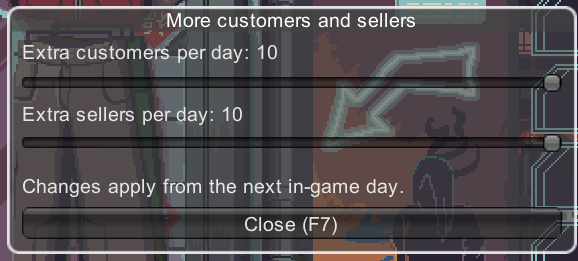

# More Customers and Sellers

A mod for [Probably Stolen](https://store.steampowered.com/app/4348910) that adds extra buyers and sellers to your shop every day, with an in-game settings window to control how busy it gets.

**Steam Workshop:** https://steamcommunity.com/sharedfiles/filedetails/?id=3830266605



## Features

- **Extra buyers**: up to 10 more customers who come to buy from you each day
- **Extra sellers**: up to 10 more sellers bringing you stock to buy
- **F7 settings window**: open it anywhere (main menu or mid-shift) and drag the sliders
- Settings are saved automatically through the game's `ModConfig` system

## Usage

1. Subscribe on the Steam Workshop (or copy the built mod into `<game>/Mods/more_customers/`)
2. Activate it in the game's **Mods** menu, then restart the game
3. Press **F7** and set the sliders (0 = vanilla, 10 = very busy)
4. Changes apply from the **next in-game day**

## Good to know

- This mod changes the game's economy: more trade means more money and stock than the game is balanced for
- Extra buyers and sellers only appear after the story intro (day 14+). Story and scripted visitors are untouched
- Your front counter fills up faster with more traders. Clear it before the weekly supplier arrives, or some of their stock won't fit and will be lost
- Built for game version **0.46D**

## How it works

I found the customer logic by decompiling the game's `Assembly-CSharp.dll` with ILSpy and tracing how each day's customers are generated in `StoreClientManager`.

| What | How |
|---|---|
| Where it hooks in | One Harmony **postfix** on `StoreClientManager.HandleNormalClient()`, which runs right after the game picks the day's normal customers |
| Extra buyers | First a buyer matched to your most-stocked item type (`PickShopperClient()`), then customers from the game's general pool filtered with `IsClientBuying()`, preferring pure buyers |
| Extra sellers | First the game's dedicated seller list (`PickSupplierClient()`), then the general pool filtered with `IsClientSelling()`, preferring pure sellers |
| No duplicates | A visitor already coming that day is skipped, since the game removes duplicates anyway |
| Settings | Two `ConfigEntry<int>` values registered with the game's `ModConfig` API (range 0–10), saved automatically |
| F7 window | A small Unity IMGUI window drawn by a `MonoBehaviour`, scaled to the screen resolution |

**What I learned along the way:** my first version raised the game's daily customer count (`GetNormalCustomerCount()`), but testing showed the game fills those extra spots with random visitors, and most turned out to be sellers. Filtering by `IsClientBuying()` / `IsClientSelling()` gives players the mix they actually asked for.

**Possible conflicts:** other mods that patch `HandleNormalClient`.

## Changelog

- **1.1**: The customers slider is now an "Extra buyers" slider that only adds buyers. Extra sellers reach the slider number more reliably.
- **1.0**: First release.

## Building from source

**Requirements**
- Probably Stolen installed (the project references the game's DLLs from your own install; none are included here)
- [.NET SDK](https://dotnet.microsoft.com/download) 6.0 or later

**Steps**
1. Clone this repo into `<game folder>/Modding/more_customers/`
2. In that folder, run:
   ```
   dotnet build -c Release
   ```
3. The build automatically installs the mod into `<game folder>/Mods/more_customers/`

If your project is somewhere else, change `GameDir` in `more_customers.csproj` to point to your game folder.

## Credits

- Made by **Luviein**
- Built with the official [Probably Stolen modding guide](https://github.com/dragonpan2/probably-stolen-modding)
- Uses [Harmony](https://github.com/pardeike/Harmony), which ships with the game

## License

[MIT](LICENSE)
